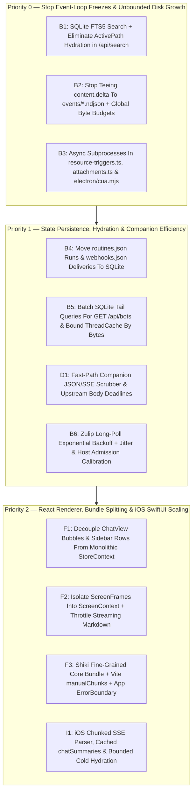

# Performance, Reliability, And Efficiency Report (2026-10-16)

**Seat:** `[AG]`
**Board Item:** `88ac424b` (`[BF][AG] Performance, reliability, and efficiency audit + small-win fixes`)
**Scope:** Live macOS runtime diagnostics (`app.botfleet.server`, `app.botfleet.macos`, `~/.botfleet`), backend harness (`server/`), React web client (`src/`), Electron shell (`electron/`), Companion proxy (`companion/`), and iOS client (`ios/`).

---

## 1. Executive Summary And Live Runtime Telemetry

On October 16, 2026, a full-stack audit was conducted across the live BotFleet runtime and repository source code.  Three systemic bottlenecks dominate real-world responsiveness, CPU utilization, and disk growth:

1. **Main-Thread Event-Loop Stalls Under Host Contention:**
   - The local MacBook Air host was observed at a load average of `515.76 / 230.58 / 127.30` on 10 cores, driven primarily by **120 runnable (`Rs`) iOS Simulator processes** (`iOS 27.0.simruntime`) plus 12 `xpcproxy_sim` processes saturating the kernel scheduler.
   - Under this load, `GET http://127.0.0.1:8799/health` timed out (`>5,018 ms`) even though `app.botfleet.server` (PID `35299`, RSS ~`146 MB`) was listening on `127.0.0.1:8799`.
   - `~/Library/Logs/botfleet/server.log` recorded CLI health probes (`claude auth status`, `agy --version`, `cursor-agent --version`) stalling for `39s` to `170s`, all 8 engine `describe` probes exceeding their `30s` deadline simultaneously, and all 8–11 Zulip bot long-poll loops reconnecting in synchronized lockstep (`retrying in 5s` with zero jitter).
   - Synchronous filesystem and subprocess operations on the harness main thread (`execFileSync` in `server/resource-triggers.ts`, `sips` image transcoding in `server/attachments.ts`, synchronous `writeFileAtomic` + `fsyncSync`, and multi-second synchronous SQLite full-table scans in `server/message-db.ts`) freeze HTTP request handling, SSE streaming, and webhook intake.

2. **Idle Electron Renderer CPU Burn (`85.1%` Combined CPU):**
   - `BotFleet Helper (Renderer)` (PID `65071`, RSS `301 MB`) was consuming **`65.2%` CPU** while idle, and `BotFleet Helper (GPU)` (PID `65037`, RSS `87 MB`) was consuming **`19.9%` CPU** (`85.1%` combined).
   - Code inspection traced this directly to two bugs:
     - `src/components/Sidebar.tsx:1875` passed `animated={Boolean(bot.busy) || Boolean(bot.unread) || ...}`, keeping a 60fps `requestAnimationFrame` 3D projection loop (or looping GIF) running indefinitely on every sidebar bot with an unread background turn.
     - `src/components/CursorAvatar.tsx:1583` ran a perpetual 4Hz `setTimeout(() => requestAnimationFrame(step), 250)` polling loop on every *paused* mascot avatar on screen, plus several settings lists (`BotPickerList`, `ResourceTriggersPanel`, `FleetModelsSection`) omitted `animated={false}`.

3. **Unbounded `~/.botfleet` Storage Growth (`8.7 GB`, Up `+67%` Since Oct 7 And `+149%` Since Sep 24):**

| Path | Sep 24, 2026 | Oct 7, 2026 | Oct 16, 2026 | Primary Growth Driver |
|---|---:|---:|---:|---|
| `~/.botfleet/` (Total) | `3.5 GB` | `5.2 GB` | **`8.7 GB`** | Unbounded per-bot workspaces, native driver logs, and SSE delta logs |
| `workspaces/` | — | `2.4 GB` | **`4.7 GB`** | Per-bot working directories and build artifacts with no eviction |
| `native/` | — | `1.9 GB` | **`2.6 GB`** | Raw provider/ACP transcripts (`434` files, only 30-day age sweep) |
| `events/` | — | `315 MB` | **`501 MB`** | `1,069` `.ndjson` files; ~`76%` of lines are per-token `content.delta` events |
| `messages.db` (+ WAL) | `54 MB` | `204 MB` | **`385 MB`** | Transcript rows (`65,786` messages across `1,093` threads) |
| `attachments/` | — | `197 MB` | **`243 MB`** | `2,949` files, mostly synthesized `.mp3` TTS audio clips (`tts-*.mp3`) |
| `item-io/` | — | `135 MB` | **`142 MB`** | `11,264` per-tool output files across `365` directories |
| `*.bak*` + `routines.json` | — | `69 MB` | **`~90 MB`** | `5.3 MB` whole-file JSON rewrite (`2,001` runs) + stale backup snapshots |

---

## 2. Small Wins Implemented In This Lane

Fourteen targeted, low-risk fixes were implemented and verified in this lane across the React frontend and Node.js backend:

### Frontend / Renderer Small Wins
1. **Prevent Crash-Loop On Out-Of-Range Numeric HTML Entities (`src/lib/plain-preview.ts`, `src/lib/plain-preview.test.ts`):**
   - **Problem:** `decodeEntities` passed arbitrary decimal/hex entity values (`&#...;`, `&#x...;`) straight to `String.fromCodePoint(code)` with no range guard.  Any code point `> 0x10FFFF`, `0`, or UTF-16 surrogate (`0xD800–0xDFFF`) in a bot's last message threw an uncaught `RangeError` inside `Sidebar` and `ChatView`, blanking the entire application on render and every relaunch.
   - **Fix:** Added `isValidCodePoint(code)` before `String.fromCodePoint(code)` so invalid numeric entities are left literal instead of crashing the render tree.  Added regression tests in `src/lib/plain-preview.test.ts`.
2. **Eliminate Idle 4Hz Wakeups On Paused Mascots And Pause Hidden-Window rAF Loops (`src/components/CursorAvatar.tsx`):**
   - **Problem:** `CursorAvatar` scheduled `setTimeout(() => requestAnimationFrame(step), 250)` in a perpetual loop whenever `paused={true}`, waking the main thread 4 times per second per static mascot on screen.  Furthermore, active mascots continued running 60fps 3D projection loops when the Electron window or browser tab was hidden.
   - **Fix:** Updated the `useEffect` in `CursorAvatar.tsx` to paint once and return immediately when `paused` is true (re-running via `[paused, state, expression, paint]` dependencies only when visual props change), and gated active `requestAnimationFrame` scheduling on `document.visibilityState === "visible"` with a `visibilitychange` listener.
3. **Stop 60fps Mascot Animation On Idle Unread Sidebar Bots And Settings Lists (`src/components/Sidebar.tsx`, `src/components/BotPickerList.tsx`, `src/components/ResourceTriggersPanel.tsx`, `src/components/FleetModelsSection.tsx`):**
   - **Problem:** `Sidebar.tsx:1875` included `Boolean(bot.unread)` in `animated={...}`, causing every bot with an unread background message to run a continuous 60fps animation loop forever while idle.  In addition, `BotPickerList.tsx`, `ResourceTriggersPanel.tsx`, and `FleetModelsSection.tsx` omitted `animated={false}` on `<BotAvatar>`, defaulting to `animated = true`.
   - **Fix:** Removed `Boolean(bot.unread)` from `animated` in `Sidebar.tsx` (the unread badge dot already signals unread state) and passed `animated={false}` in `BotPickerList.tsx`, `ResourceTriggersPanel.tsx`, and `FleetModelsSection.tsx`.
4. **Hoist And Memoize Markdown Plugins And Component Renderers (`src/components/ChatMarkdown.tsx`):**
   - **Problem:** `ChatMarkdownComponent` allocated a fresh `remarkPlugins={[remarkGfm, remarkMentions]}` array and a fresh 15-entry `components={{ ... }}` object literal on every render.  During 60fps token streaming, React tore down and recreated component closures on every token.
   - **Fix:** Hoisted `REMARK_PLUGINS` and `STATIC_MARKDOWN_COMPONENTS` to module scope and memoized `components` via `useMemo` keyed on `[streaming]`.
5. **Pause Cloud Computer Preview Polling When Window Is Hidden (`src/components/ComputerPanel.tsx`):**
   - **Problem:** Local and VM screenshot polling effects checked `!pageVisible`, but the cloud screenshot polling effect (`POST /api/bots/:id/computer/screenshot` every 4s–12s) omitted `!pageVisible`, continuing expensive remote SSH screen captures while the app window was hidden or minimized.
   - **Fix:** Added `!pageVisible` guard and dependency to the cloud preview polling `useEffect`.
6. **Guard 30s Quota Polling On Visibility And Abort In-Flight Fetches On Unmount (`src/components/UsageSection.tsx`):**
   - **Problem:** `UsageSection` polled `/api/quotas` every 30s even when hidden and did not abort in-flight `/api/telemetry/status` or `/api/quotas` requests on unmount.
   - **Fix:** Added an `AbortController` cleaned up on unmount and skipped interval ticks when `document.visibilityState === "hidden"`.
7. **Shorten Export Blob URL Revocation From 60s To 1s (`src/lib/team-files.ts`):**
   - **Problem:** `downloadPlaybook` and `downloadAllConversations` pinned multi-megabyte full-transcript JSON `Blob` URLs in renderer memory for `60,000 ms` after `link.click()`.
   - **Fix:** Reduced `URL.revokeObjectURL` delay to `1,000 ms`.
8. **Stop Screen-Reader 1Hz Live-Region Spam (`src/components/TurnPresence.tsx`):**
   - **Problem:** `TurnPresence` placed the 1Hz `· ${elapsed}s` timer inside an `aria-live="polite"` region, causing assistive technologies to re-read the entire status line every second.
   - **Fix:** Scoped `aria-live="polite"` to the phase label and marked the 1Hz elapsed counter `aria-hidden="true"`.

### Backend / Harness Small Wins
9. **Fix `ThreadCache.retained` Drift And Eviction Bypass On In-Place Message Appends (`server/store.ts`, `server/store.test.ts`):**
   - **Problem:** `ThreadCache` tracked `this.retained` (capped at `20,000` messages) only inside `set()` and `delete()`.  When `Store.appendMessage()` or `Store.branchMessage()` pushed new messages directly onto a cached `ThreadState.messages` array (`t.messages.push(full)`), `this.retained` was never incremented and `evict()` was never called.  Even worse, when that thread was later evicted, `this.retained -= victim.messages.length` subtracted the grown length from the smaller initial count, driving `this.retained` negative and disabling the `maxMessages` bound across the cache.
   - **Fix:** Added `ThreadCache.recordAppend(threadId)` and invoked it in `appendMessage` and `branchMessage`, keeping `this.retained` exact and evicting older LRU threads when `maxMessages` is crossed.  Added a regression test in `server/store.test.ts`.
10. **Fast-Path `RoutinesEngine.handleRuntimeEvent` And Fix Cleared `hotDeferredAt` Wait-Time Log (`server/routines.ts`):**
    - **Problem:** `handleRuntimeEvent(event)` scanned all `2,001` runs (`this.runs.find(...)` with an array allocation `["running", "waiting"].includes(r.status)`) on *every* runtime event, even though ~`76%` of events are `content.delta` token chunks and `tool.*` updates that `handleRuntimeEvent` ignores.  Additionally, in `tick()`, `run.hotDeferredAt = undefined` was executed 3 lines *before* `const hotSince = run.hotDeferredAt ?? run.createdAt`, causing `hotSince` to always fall back to `run.createdAt`.
    - **Fix:** Added an O(1) event-type guard at the top of `handleRuntimeEvent`, replaced `["running", "waiting"].includes(...)` with `(r.status === "running" || r.status === "waiting")`, and captured `hotSince` before clearing `run.hotDeferredAt`.
11. **Eliminate 500ms Array Spread Allocation In `JobRegistry` (`server/jobs/registry.ts`):**
    - **Problem:** Every `500 ms`, `logTimer` evaluated `[...this.records.values()].some((record) => record.status === "running")`, allocating and copying a 500+ element array twice a second even when zero jobs were running.
    - **Fix:** Replaced with a zero-allocation `hasRunningJob()` iterator loop over `this.records.values()`.
12. **Skip Redundant Synchronous `fsyncSync` Disk Writes In `QuotaCooldownRegistry` (`server/model-fallback.ts`, `server/model-fallback.test.ts`):**
    - **Problem:** `recordInstanceCap` and `clear` unconditionally called `this.persist()` (which performs a synchronous `writeFileAtomic` + `fsyncSync` on the main thread), even when periodic 30s quota polling reported an unchanged active cooldown or cleared a bot with no cooldown entries.
    - **Fix:** Short-circuited `recordInstanceCap` when an identical non-expired entry already exists, and gated `this.persist()` in `clear()` on an entry actually being deleted.  Added a unit test in `server/model-fallback.test.ts`.
13. **Right-Size Buffer Allocation In `readLocalQuotaSnapshot` (`server/local-usage-monitor.ts`):**
    - **Problem:** `readLocalQuotaSnapshot` allocated and zero-filled a `1 MiB` buffer (`Buffer.alloc(MAX_BYTES + 1)`) every 30 seconds to read a ~2 KB `quota-windows.json` file.
    - **Fix:** Allocated initial capacity from `stat.size + 1024` (minimum `4096` bytes, growing up to `MAX_BYTES + 1` only if needed).
14. **Bound `HelperTracker.settledKeys` And Enforce Default `boxFetch` Timeout (`server/helpers/tracker.ts`, `server/box.ts`):**
    - **Problem:** `HelperTracker.settledKeys` (`Set<string>`) grew without bound over the life of the server process, and `boxFetch` in `server/box.ts` had no default `AbortSignal.timeout`, allowing hung `ascii.dev` calls to wedge requests indefinitely.
    - **Fix:** Capped `settledKeys` at 500 FIFO entries and added `signal: opts.signal ?? AbortSignal.timeout(30_000)` to `boxFetch`.

---

## 3. Larger Architectural Improvements Roadmap

The following larger or multi-component engineering initiatives are prioritized by user-visible impact and risk reduction.

---

### Track A: Backend Harness, Database & Storage Architecture

#### A1. Full-Text Search (`FTS5`) And Non-Hydrating `/api/search` (`server/message-db.ts:464-515`, `server/index.ts:12725-12735`)
- **Root Cause:** `searchMessages` runs `SELECT thread_id, id, json FROM messages WHERE lower(json) LIKE ? ORDER BY rowid DESC` across all `65,786` rows (`380 MB` SQLite table), scanning raw JSON strings including base64 attachments and tool payloads.  Worse, for every matching row (up to `800` rows), it calls `opts.activeIds(row.thread_id)` (`store.activePath(threadId)`), which hydrates the *entire* thread from SQLite (`readThread`) and walks parent pointers synchronously on the main event loop.
- **Measured Impact:** A single `/api/search?q=the` query takes **`1.8s` to `7.2s`** of synchronous main-thread execution, freezing all HTTP endpoints and SSE streams on every keystroke.
- **Recommended Fix:**
  1. Add a `role` and `text` projection column (or an SQLite `FTS5` virtual table `messages_fts(thread_id UNINDEXED, message_id UNINDEXED, text)`) populated on `insertMessage`/`updateMessage`.
  2. Persist an `on_active_path INTEGER` bit on `messages` (or compute active-branch membership in SQL via a recursive CTE scoped only to distinct candidate `thread_id`s) so `/api/search` never calls `store.activePath(threadId)`.
  3. Debounce client search input (`200 ms`) and pass an `AbortController` signal in `src/components/SearchModal.tsx`.

#### A2. Stop Teeing `content.delta` To `events/*.ndjson` And Enforce Global Storage Byte Budgets (`server/drivers/event-log.ts`, `server/store.ts`, `server/attachments.ts`)
- **Root Cause:** Every streamed token (`content.delta`) is serialized to JSON and appended to `~/.botfleet/events/<threadId>.ndjson`, accounting for **~`76%` of all lines** across `501 MB` of event logs (`1,069` files) even though the settled assistant message is already persisted in `messages.db`.  Meanwhile, `workspaces/` (`4.7 GB`), `native/` (`2.6 GB`), `attachments/` (`243 MB`, including `tts-*.mp3` speech syntheses), and `item-io/` (`142 MB`) have no global byte ceilings, and `*.bak*` files (`~85 MB`) have no retention sweep.
- **Recommended Fix:**
  1. Exclude `content.delta` from `events/<threadId>.ndjson` (persist only turn lifecycle, tool invocations, requests, errors, and completed items).
  2. Enforce global byte caps with oldest-idle-first eviction in the 6-hour sweep:
     - `native/` + `events/`: `500 MB` cap (7-day max age, `5 MB` per-thread rotation).
     - `item-io/`: `100 MB` cap (7-day max age).
     - `attachments/`: TTL sweep (24–72 hours) for synthesized `tts-*.mp3` clips; deduplicate uploaded blobs by SHA-256 content hash.
     - `*.bak*`: delete backup files older than 14 days once the primary file parses cleanly, keeping at most the newest 2 backups per file.

#### A3. Migrate `routines.json` Runs And `webhooks.json` Deliveries To SQLite (`server/routines.ts:757-770`, `server/webhooks.ts:466-476`)
- **Root Cause:** `RoutinesEngine.save()` serializes all routines and up to `2,000` `RoutineRun` records (each carrying a copy of the routine's full `prompt` text) into a **`5.3 MB` JSON file** (`~/.botfleet/routines.json`) via synchronous `writeFileAtomic` (`fsyncSync`) on every run state transition (`queued` → `running` → `session.started` → `item.completed` → `completed`).  A single routine turn triggers 4–5 synchronous `5.3 MB` disk rewrites (~`21–27 MB` written per turn).
- **Recommended Fix:**
  1. Move `routine_runs` and `webhook_deliveries` into SQLite tables in `messages.db` (or `automation.db`) with indexed `(thread_id, status)` and `(routine_id, created_at)` columns so each state transition is a single indexed `UPDATE`.
  2. Store `prompt` on `routine_runs` only when overridden (`manual` / `webhook` / `resource`), referencing the routine definition otherwise.
  3. Prune terminal routine runs older than 14 days (and cap at 500 runs total).

#### A4. Batch SQLite Hydration In `GET /api/bots` And Eliminate Full-Thread Loads In `publicBot` (`server/index.ts:2891-2914, 12671-12684`, `server/message-db.ts:167-181`)
- **Root Cause:**
  1. `GET /api/bots?messages=50` calls `messagePage(threadId, 50)` for every bot and room, executing 2 separate SQLite queries per thread (`60+` synchronous queries per request).
  2. `publicBot(bot)` and `wireTask(task)` call `store.messagesFor(t.threadId)` (full-thread hydration into `ThreadCache`) on every task whose `activityAt` is unset or that has a single-turn title fallback, and `publicBot` walks `store.activePath(bot.threadId)` to compute `pendingRequest`.
- **Recommended Fix:**
  1. Add a single batched `readThreadsTail(threadIds: string[], limit: number)` query using a window function (`ROW_NUMBER() OVER (PARTITION BY thread_id ORDER BY rowid DESC) <= ?`).
  2. Persist `activityAt` and `lastPreview` on `BotTask` / `BotRecord` during `appendMessage`, and read `pendingRequest` from an in-memory `Map<string, PendingRequest>` on `Store` instead of walking `activePath()`.
  3. Add an explicit `resetMessageDbForTesting()` helper in `server/message-db.ts` so `db()` does not call `existsSync(DB_FILE())` 3–4 times per SQLite query in production, and cache `SECTION_CONTEXTS_FILE` in memory in `server/section-context.ts` (invalidated on write).

#### A5. Convert Synchronous Subprocesses And File I/O On Hot Paths To Async (`server/resource-triggers.ts`, `server/attachments.ts`, `server/tools/computer.ts`, `server/static-files.ts`)
- **Root Cause:**
  - `server/resource-triggers.ts:195-328` spawns 3 synchronous subprocesses (`vm_stat`, `df -k`, `sysctl vm.swapusage`) via `execFileSync` every 30s, followed by synchronous `writeFileAtomic` (`fsyncSync`).
  - `server/attachments.ts:75-164` runs `execFileSync("sips", ...)` (up to `20s` timeout) plus `readFileSync`/`writeFileSync` on the main thread during image uploads and attachment downloads.
  - `server/tools/computer.ts:211-372` uses `readFileSync`/`writeFileSync` inside async tool handlers.
  - `server/index.ts:18335-18356` serves static bundle files with `realpathSync` + `readFileSync` and zero `ETag` / `Cache-Control` headers.
- **Recommended Fix:** Convert `sampleHost` in `resource-triggers.ts` and `jpegFromAppleImage` in `attachments.ts` to async `execFile` with `Promise.all`; switch `computer.ts` file tools to `node:fs/promises`; and stream static assets/attachments with `fs.createReadStream` and `Cache-Control: public, max-age=31536000, immutable` on hashed `/assets/*` files.

#### A6. Zulip Reconnect Jitter + Exponential Backoff And Host Admission Calibration (`server/channels/zulip.ts`, `server/jobs/admission.ts`)
- **Root Cause:** When the harness event loop stalls or network connectivity blips, all 8–11 Zulip bot polling loops drop simultaneously and retry on a fixed `5s` delay with zero jitter, creating a synchronized reconnect storm every 5 seconds.  Meanwhile, `server/jobs/admission.ts` sets `DEFAULT_MAX_SWAP_PCT = 98`, which only sheds load after macOS swap is already thrashing.
- **Recommended Fix:** Add exponential backoff (`2s` base → `60s` cap) with `±30%` random jitter to `server/channels/zulip.ts`, lower `DEFAULT_MAX_SWAP_PCT` to `85%`, and add a global concurrency semaphore (max `2` concurrent CLI `--version` / `auth status` health probes) so startup or settings refreshes never spawn 8+ heavy CLIs at once.

---

### Track B: Frontend / React Renderer Architecture

#### B1. Decouple `ChatView` Bubbles And `Sidebar` Rows From `StoreContext` (`src/components/ChatView.tsx`, `src/components/Sidebar.tsx`, `src/state/store.tsx`)
- **Root Cause:** `StoreContext` provides a single `{ state, dispatch, ... }` object (`src/state/store.tsx:2225`) without splitting state from dispatch or supporting selectors.  `MessagesList` (`ChatView.tsx:2236`) and every individual `Bubble` (`ChatView.tsx:1487`) call `useStore()`, and neither `Bubble` nor `Sidebar` row items (`BotListItem`, `GroupListItem`, `ThreadListItem`) are wrapped in `React.memo`.  Every SSE event anywhere in the fleet (`bot`, `message`, `presence`, `routine.run`) forces a full re-render of every message bubble in the open conversation and every row in the sidebar.
- **Recommended Fix:**
  1. Split `StoreDispatchContext` (stable functions) from `StoreStateContext` in `src/state/store.tsx`.
  2. Pass primitive/scoped props (`botColor`, `botAvatarUrl`, `senderBot`, callbacks) down from `ChatView` to `Bubble` and wrap `Bubble`, `BotListItem`, `GroupListItem`, and `ThreadListItem` in `React.memo`.
  3. Cache `visibleMessages(bot)` in a `WeakMap<Message[], Message[]>` keyed on `bot.messages` and active leaf ID so `Sidebar` does not rebuild `Map`s and walk parent pointers on unrelated state updates.

#### B2. Isolate Live `screenFrame` Updates Into `ScreenContext` And Throttle Streaming Markdown (`src/state/store.tsx:1744`, `src/components/ChatMarkdown.tsx`)
- **Root Cause:** Every `screen` SSE frame stores a multi-hundred-kilobyte base64 image in `AppState.screenFrames[threadId]` (`store.tsx:1744`), triggering a global `StoreContext` re-render of the entire application even when `ComputerPanel` is closed.  Meanwhile, during token streaming (`60fps`), `ChatMarkdown` runs `unified` + `remark-parse` + `remark-gfm` + `remarkMentions` full AST parsing on the entire growing message string every `16ms`.
- **Recommended Fix:**
  1. Move `screenFrames` out of `AppState` into a dedicated `ScreenContext` (mirroring `StreamContext`), subscribed to only by `ComputerPanel`.
  2. Throttle markdown re-parsing in `ChatMarkdown` during `streaming={true}` to once every `80–100 ms` (or only re-parse completed paragraph blocks while rendering the trailing active line as plain text).

#### B3. Code-Split Monolithic `2.0 MB` Bundle, Switch Shiki To Fine-Grained Core, And Mount Root `ErrorBoundary` (`vite.config.ts`, `src/components/ChatMarkdown.tsx`, `src/main.tsx`)
- **Root Cause:** `vite.config.ts` defines no `build.rollupOptions.output.manualChunks`, producing a single **`2,000 KB` (`568 KB` gzipped)** entry chunk, while `import("shiki")` emits 150+ grammar chunks (`wasm.mjs` `648 KB`, `emacs-lisp` `402 KB`, `cpp` `596 KB`).  Additionally, `src/main.tsx` mounts `<App />` with no top-level React `ErrorBoundary`.
- **Recommended Fix:**
  1. Switch `ChatMarkdown.tsx` from `import("shiki")` to `shiki/core` with `shiki/engine/javascript` and a curated set of ~20 common languages loaded on demand.
  2. Configure `manualChunks` in `vite.config.ts` to separate `vendor-react`, `vendor-markdown`, `vendor-Sentry/PostHog`, and `vendor-icons`.
  3. Wrap `<App />` in `src/main.tsx` with a root `ErrorBoundary` (integrated with `@sentry/react`) that offers a "Reload View" recovery action instead of a blank screen.

---

### Track C: Electron Shell, Companion Proxy & iOS App

#### C1. Electron Main-Thread Non-Blocking I/O, JPEG Screen Frames & Helper Process Cleanup (`electron/main.mjs`, `electron/cua.mjs`, `electron/speech.mjs`, `electron/skill-recorder.mjs`, `electron/updater.mjs`)
- **Root Cause:**
  1. `electron/main.mjs:230-248` (`writeWindowState`) runs synchronous `mkdirSync`, `writeFileSync`, and `renameSync` on the main process thread during window resize/move.
  2. `electron/main.mjs:1664-1677` (`screen:frame` IPC) encodes `1280x800` captures as uncompressed PNG base64 (`thumbnail.toDataURL()`, `2.5–4 MB` per frame) instead of `thumbnail.toJPEG(75)` (~`100 KB`, `>95%` smaller).
  3. `electron/cua.mjs:163-175` blocks the Electron main thread for up to `8s` via `spawnSync("open", ["-a", "CuaDriver"])`.
  4. `electron/speech.mjs` and `electron/skill-recorder.mjs` poll temp files at `20–25 Hz` via `fs.watchFile(..., { interval: 40 })` + `readFileSync` and only write a `stop` marker file on exit, risking orphaned helper processes holding microphone/accessibility permissions.
  5. `electron/updater.mjs:362-383` recomputes `macAppFingerprint()` (synchronous `readFileSync` + `statSync`) on every hourly poll before checking whether `autoUpdateEnabled` is true or the 6-hour throttle window has elapsed.
- **Recommended Fix:** Convert `writeWindowState` to `fs.promises`; encode `screen:frame` thumbnails with `toJPEG(75)`; replace `probeNativeSync` in `cua.mjs` with async `execFile`; cache `macAppFingerprint()` once per process lifetime; and enforce a `SIGTERM` → `SIGKILL` fallback on speech/recorder helper PIDs during `before-quit`.

#### C2. Companion Proxy Fast-Path JSON/SSE Scrubbing & Upstream Body Deadlines (`companion/src/proxy.ts`, `companion/src/wire.ts`)
- **Root Cause:**
  1. `companion/src/proxy.ts:580-613` and `companion/src/wire.ts:132-151` parse, recursively deep-clone every object/array via `scrub()`, and re-stringify *every* JSON HTTP response (up to `32 MB`) and *every* SSE `data:` frame, purely to strip two keys (`resumeCursors` and `sshAlias`).  For a `5–10 MB` fleet payload or rapid SSE token stream, this causes `4x–6x` transient heap amplification even when neither key appears in the payload.
  2. `companion/src/proxy.ts:394-395` clears `headersDeadline` once response headers arrive and arms no body completion timeout for non-streaming (`!isStream`) requests, leaking sockets if the loopback harness stalls mid-body.
- **Recommended Fix:**
  1. In `wire.ts` and `proxy.ts`, add a fast-path check: if a validated JSON string does not contain `"resumeCursors"`, `"sshAlias"`, or `\\u` unicode escapes, skip `scrub()` deep-cloning and `JSON.stringify` altogether.
  2. Arm a `60s` response body completion deadline on non-streaming upstream requests in `companion/src/proxy.ts`.

#### C3. iOS Chunked SSE Parser, Cached `chatSummaries`, Background Avatar Decoding & Bounded Cold Hydration (`ios/Sources/CompanionCore/SSE.swift`, `ios/App/Session.swift`, `ios/App/BotAvatarView.swift`, `ios/App/ChatView.swift`)
- **Root Cause:**
  1. `SSE.swift:139-174` iterates `URLSession.AsyncBytes` one byte at a time (`for try await byte in bytes`) and performs a triple UTF-8 roundtrip (`[UInt8]` → `String` → `Data` → `JSONDecoder`) per line.
  2. `Session.swift:3947-3965` defines `chatSummaries` as an unmemoized computed property that iterates all bots/rooms, resolves transcripts, and runs O(N log N) sorting 5–10 times per `ChatListView.body` evaluation on every incoming SSE frame.
  3. `Session.swift:800-813` (`coldHydration: while true`) loops with zero backoff whenever `hydrateSnapshot` returns `.newerState`.
  4. `BotAvatarView.swift:61-68` caches raw `NSData` in `NSCache` and runs `UIImage(data:)` synchronous image decompression on `@MainActor` during scroll layout.
  5. `ChatView.swift:420-435, 1717` renders the transcript in an eager `VStack` subscribed to the monolithic `@Published var state: CompanionState`, re-diffing and re-parsing markdown for every bubble on every streamed token.
- **Recommended Fix:** Consume SSE bytes in chunked buffers; cache `chatSummaries` on `CompanionState` (invalidated only when bots, rooms, or messages change); bound `coldHydration` to 5 attempts with `150 ms` backoff; cache decoded `UIImage` instances off the main actor; and isolate active streaming text from the global `CompanionState` publish cycle.
